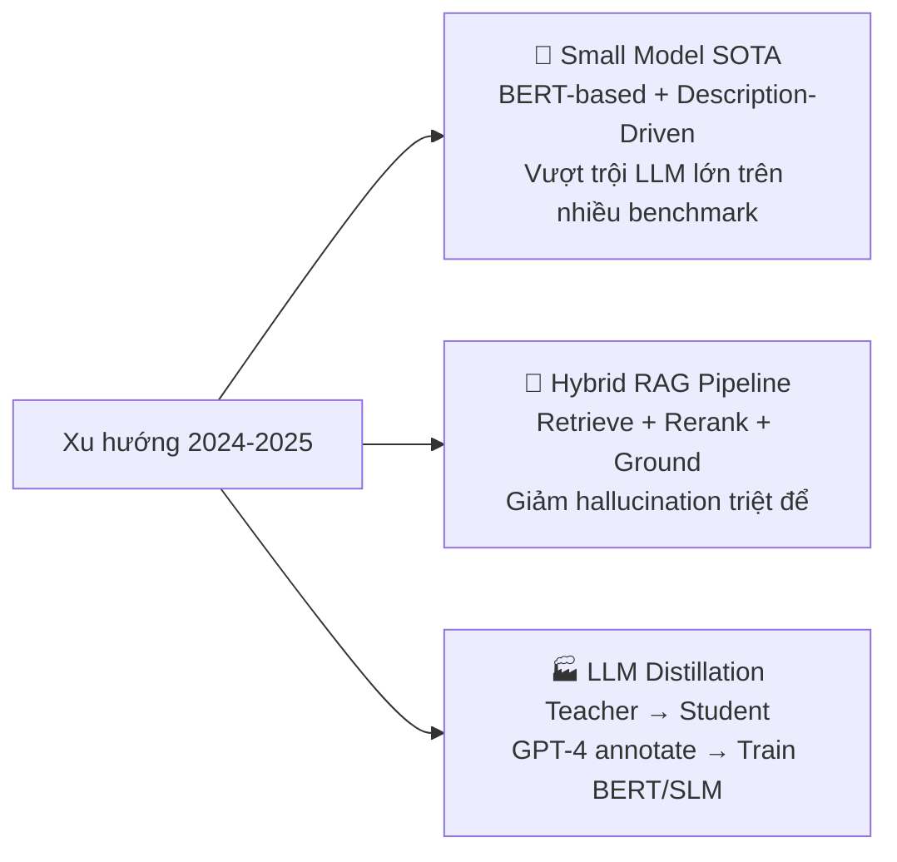
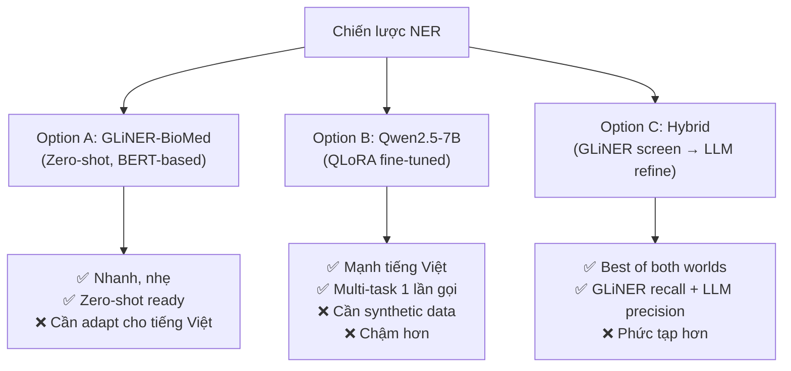
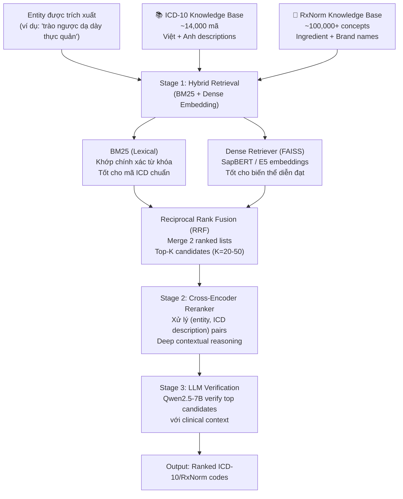
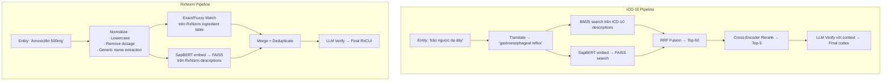
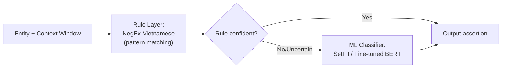
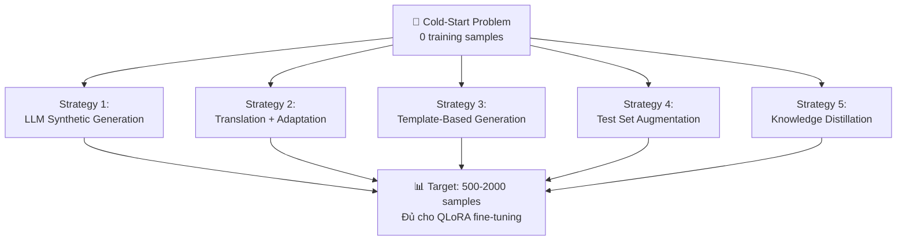
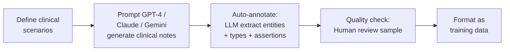
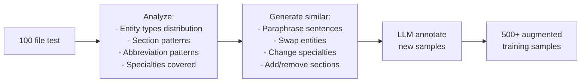
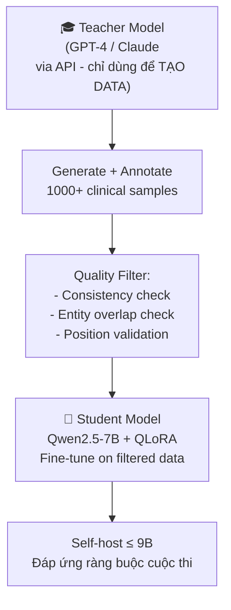
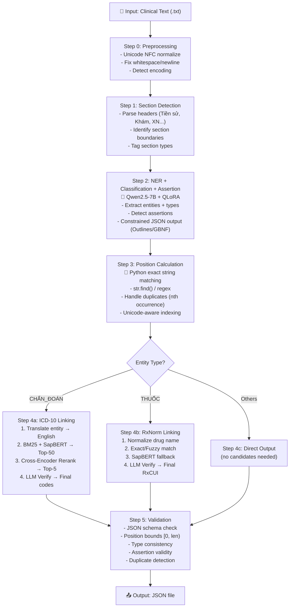

# 🔬 Báo Cáo Nghiên Cứu SOTA — Clinical NLP cho Bài Toán Viettel

> **Tổng hợp giải pháp State-of-the-Art toàn cầu** — Cập nhật: 2026-07-06
> Phạm vi: Zero-shot Clinical NER + Entity Linking + Assertion Detection trên mô hình ≤ 9B params

---

## Mục Lục

1. [Tổng Quan Bối Cảnh Nghiên Cứu](#1-tổng-quan-bối-cảnh-nghiên-cứu)
2. [NER & Entity Classification — Trích Xuất Thực Thể](#2-ner--entity-classification)
3. [Entity Linking — ICD-10 & RxNorm](#3-entity-linking--icd-10--rxnorm)
4. [Assertion Detection — Ngữ Cảnh](#4-assertion-detection--ngữ-cảnh)
5. [Data Synthesis — Vượt Rào Cản Cold-Start](#5-data-synthesis--vượt-rào-cản-cold-start)
6. [Kiến Trúc Tích Hợp Đề Xuất](#6-kiến-trúc-tích-hợp-đề-xuất)
7. [Bảng Tổng Hợp Công Cụ & Mô Hình](#7-bảng-tổng-hợp-công-cụ--mô-hình)
8. [Kỹ Thuật Tối Ưu Nâng Cao](#8-kỹ-thuật-tối-ưu-nâng-cao-advanced-optimization)

---

## 1. Tổng Quan Bối Cảnh Nghiên Cứu

### 1.1 Các Shared Tasks Cốt Lõi (Benchmarks)

Bài toán Viettel là sự kết hợp của nhiều shared task kinh điển trong Clinical NLP. Dưới đây là mapping giữa các nhiệm vụ và benchmark tương ứng:

| Nhiệm vụ Viettel | Shared Task Tương Đương | Năm | Dữ liệu |
|---|---|---|---|
| **NER + Classification** | i2b2 2010 — Concept Extraction | 2010 | Discharge summaries, 3 loại (Problem, Test, Treatment) |
| **Assertion Detection** | i2b2 2010 — Assertion Classification | 2010 | 6 loại: Present, Absent, Possible, Conditional, Hypothetical, Associated with Someone Else |
| **Entity Linking (ICD-10)** | ShARe/CLEF eHealth 2013–2014 — Disorder Normalization | 2013-14 | MIMIC-II → SNOMED CT / UMLS CUI |
| **Entity Linking (RxNorm)** | n2c2 2022 Track 1 — Contextualized Medication Event | 2022 | Medication mention extraction + context (action, negation, temporality, certainty, actor) |
| **Multi-task NER+Linking** | SNOMED CT Entity Linking Challenge 2024 | 2024 | Free-text clinical notes → SNOMED codes |
| **Toàn bộ pipeline** | n2c2 2022 — All Tracks | 2022 | Medication extraction + SDOH + Progress note reasoning |

### 1.2 Xu Hướng Chính 2024–2025

Nghiên cứu SOTA đã chuyển hướng mạnh theo 3 trục chính:



> [!IMPORTANT]
> **Phát hiện then chốt**: Các mô hình nhỏ (BERT-based, ~100-350M params) được huấn luyện đúng cách **thường xuyên vượt trội LLM lớn** (GPT-4, Claude) trên các benchmark NER y khoa cụ thể. Xu hướng 2025 là dùng LLM lớn như "teacher" để tạo dữ liệu, sau đó train mô hình nhỏ chuyên biệt.

---

## 2. NER & Entity Classification

### 2.1 Phương Pháp SOTA cho Mô Hình Tham Số Nhỏ

#### 🏆 Tier 1: Description-Driven Small Models (BERT-based, ~100-350M params)

Đây là hướng SOTA mới nhất (2025), đạt hiệu suất cao nhất trên các benchmark zero-shot:

| Framework | Kiến trúc | Đặc điểm | F1 Score (zero-shot) |
|---|---|---|---|
| **ZeroNER** (IBM, 2025) | BERT encoder + entity type descriptions | Distill knowledge từ LLM, dùng mô tả entity thay vì label → vượt LLM lớn 16% F1 | **Cao nhất** trên nhiều benchmark |
| **OpenBioNER** (2025) | BERT-based compact architecture | Train trên synthetic data, vượt GPT-4o và GliNER trên JNLPBA, BC4GM, BC4CHEMD | **SOTA** trên biomedical benchmarks |
| **GLiNER-BioMed** (Knowledgator) | Bidirectional transformer, text-to-label matching | Zero-shot, nhẹ, có phiên bản `small`. Train trên LLM-distilled data | Rất cạnh tranh trên clinical NER |
| **GLiClass** | BERT-based classification | 10-50x nhanh hơn cross-encoder, single forward pass | Phù hợp cho entity type classification |

**Cách hoạt động của ZeroNER/OpenBioNER:**
```
Thay vì train model nhận diện label "DISEASE":
  → Cung cấp MÔ TẢ: "A disease is a pathological condition affecting an organism, 
    characterized by specific signs and symptoms"
  → Model học "matching" giữa text span và description
  → Generalize tốt sang unseen entity types
```

> [!TIP]
> **Ứng dụng cho bài toán Viettel**: Có thể viết description bằng tiếng Việt cho 5 nhãn:
> - `TRIỆU_CHỨNG`: "Biểu hiện lâm sàng bất thường mà bệnh nhân trải qua hoặc bác sĩ quan sát được"
> - `CHẨN_ĐOÁN`: "Kết luận y khoa về tình trạng bệnh lý dựa trên thăm khám và xét nghiệm"
> - `THUỐC`: "Tên thuốc, dược phẩm, hoạt chất được kê đơn hoặc sử dụng"
> - `TÊN_XÉT_NGHIỆM`: "Tên các xét nghiệm cận lâm sàng, chẩn đoán hình ảnh"
> - `KẾT_QUẢ_XÉT_NGHIỆM`: "Giá trị số, đơn vị, kết quả định tính/định lượng của xét nghiệm"

#### 🥈 Tier 2: Instruction-Tuned LLM (≤ 9B params)

| Framework | Kiến trúc | Ưu điểm | Hạn chế |
|---|---|---|---|
| **UniversalNER (UniNER)** | LLaMA-based instruction tuning | Distill từ GPT-4, treat NER as generation, hỗ trợ arbitrary entity types | Cần GPU mạnh, chậm hơn BERT |
| **Qwen2.5-7B + QLoRA** | Causal LLM + LoRA adapters | Mạnh tiếng Việt, structured output (JSON) tốt, multilingual | Cần fine-tune, risk hallucination |
| **SLENDER** (ACL 2025) | SLM-optimized output format | Giảm inference time cho NER, giữ accuracy cao | Mới, chưa nhiều benchmark |

**SLENDER Architecture** (đáng chú ý):
```
Input:  "Bệnh nhân sốt cao 39°C, ho khan"
Output format (thay vì JSON phức tạp):
  TRIỆU_CHỨNG: sốt cao 39°C | ho khan
  → Giảm 40% token output → nhanh hơn đáng kể
  → Post-process sang JSON bằng code
```

#### 🥉 Tier 3: Framework-Level Optimization (Zero-shot LLM)

| Framework | Ý tưởng | Áp dụng |
|---|---|---|
| **Entity Decomposition with Filtering (EDF)** — NAACL 2025 | Chia NER phức tạp thành sub-type retrieval nhỏ → filter kết quả | Phù hợp khi 1 LLM xử lý cả 5 nhãn cùng lúc |
| **ZeroTuneBio NER** | 3-stage: CoT reasoning + prompt engineering → rival fine-tuned models | Zero-shot, không cần data |

### 2.2 So Sánh Chiến Lược NER



### 2.3 Kết Luận NER — Khuyến Nghị

> [!IMPORTANT]
> **Chiến lược đề xuất: Hybrid Two-Stage NER**
> 1. **Stage 1 (Recall)**: Dùng **GLiNER-BioMed** hoặc **Qwen2.5-7B zero-shot** để phát hiện candidate entities
> 2. **Stage 2 (Precision)**: Dùng **Qwen2.5-7B + QLoRA** (fine-tuned trên synthetic data) để refine span boundaries, phân loại type, và detect assertions
> 3. **Position Calculation**: Dùng **Python exact string matching** — KHÔNG bao giờ dùng LLM cho position

---

## 3. Entity Linking — ICD-10 & RxNorm

### 3.1 Kiến Trúc SOTA: Retrieve → Rerank → Ground

Đây là kiến trúc được chứng minh giảm hallucination hiệu quả nhất trong 2024-2025:



### 3.2 Chi Tiết Từng Stage

#### Stage 1: Hybrid Retrieval (BM25 + FAISS)

| Component | Tool | Chi tiết |
|---|---|---|
| **BM25 (Lexical)** | `rank_bm25` hoặc Elasticsearch | Index toàn bộ ICD-10 descriptions (Việt + Anh). Tốt cho exact match, rare terms |
| **Dense Retriever** | FAISS + SapBERT/E5 embeddings | Pre-compute embeddings cho toàn bộ ICD-10/RxNorm. Cosine similarity search |
| **Fusion** | Reciprocal Rank Fusion (RRF) | `RRF_score = Σ 1/(k + rank_i)` — merge lexical + semantic rankings |

**Lựa chọn Embedding Model:**

| Model | Params | Ưu điểm | Nhược điểm |
|---|---|---|---|
| **SapBERT-UMLS** (`cambridgeltl/SapBERT-UMLS-2020AB-all-lang-from-XLMR-large`) | 550M | SOTA medical concept normalization, multilingual, pre-trained trên UMLS | Chủ yếu tiếng Anh UMLS |
| **Multilingual E5-large** (`intfloat/multilingual-e5-large`) | 560M | Mạnh multilingual, hỗ trợ tiếng Việt tốt | Không chuyên y khoa |
| **CODER** (Contrastive Learning for Medical Ontology) | ~110M | Lightweight, tối ưu cho entity linking | Ít cập nhật gần đây |
| **MedCPT** | ~110M | Tối ưu cho clinical text retrieval | Chủ yếu tiếng Anh |

> [!TIP]
> **Khuyến nghị**: Dùng **SapBERT-XLMR** (multilingual version) cho Stage 1 Dense Retrieval. Model này đã pre-trained trên UMLS synonyms nên hiểu mapping giữa medical concepts rất tốt. Kết hợp với BM25 trên ICD-10 descriptions tiếng Việt sẽ cho recall cao nhất.

#### Stage 2: Cross-Encoder Reranking

```python
# Pseudo-code cho Cross-Encoder Reranking
from sentence_transformers import CrossEncoder

reranker = CrossEncoder('cross-encoder/ms-marco-MiniLM-L-12-v2')  
# hoặc fine-tune trên medical data

for entity in extracted_entities:
    candidates = hybrid_retrieve(entity.text, top_k=50)
    
    # Create pairs for cross-encoder
    pairs = [(entity.text + " " + entity.context, 
              candidate.icd_description) 
             for candidate in candidates]
    
    scores = reranker.predict(pairs)
    ranked = sorted(zip(candidates, scores), key=lambda x: -x[1])
    entity.candidates = [c.code for c in ranked[:5]]
```

**Tại sao Cross-Encoder quan trọng:**
- Bi-encoder (SapBERT): encode entity và ICD description **riêng rẽ** → miss contextual nuances
- Cross-encoder: process (entity, description) **cùng lúc** → hiểu sự khác biệt tinh tế
  - Ví dụ: "đau ngực" → I20.9 (Angina pectoris) vs R07.9 (Chest pain) — cần context để phân biệt

#### Stage 3: LLM Verification (Anti-Hallucination)

Đây là layer quan trọng nhất để giảm hallucination:

```
PROMPT:
Bạn là chuyên gia mã hóa y tế ICD-10.
Cho entity: "{entity_text}"
Trong ngữ cảnh: "{surrounding_context}"

Các mã ICD-10 candidate:
1. K21.0 — Trào ngược dạ dày-thực quản có viêm thực quản
2. K21.9 — Trào ngược dạ dày-thực quản không viêm thực quản
3. K20 — Viêm thực quản
4. K22.1 — Loét thực quản

Hãy chọn mã phù hợp nhất. CHỈ chọn từ danh sách trên.
Nếu không chắc chắn, chọn mã chung nhất (ít cụ thể nhất).
Trả lời: [mã_1, mã_2, ...]
```

> [!CAUTION]
> **Anti-Hallucination Critical Rule**: LLM **KHÔNG BAO GIỜ** được tự tạo mã ICD-10/RxNorm. Luôn luôn phải chọn từ danh sách candidates do retrieval cung cấp. Đây là nguyên tắc "Citation-Enforced Prompting" — buộc model trích dẫn từ nguồn cụ thể.

### 3.3 Xử Lý Đặc Thù ICD-10 vs RxNorm

| Đặc điểm | ICD-10 Linking | RxNorm Linking |
|---|---|---|
| **Kích thước KB** | ~14,000 mã (WHO ICD-10) | ~100,000+ concepts |
| **Thách thức chính** | Mapping tiếng Việt → tiếng Anh, hierarchical codes | Tên thuốc Việt vs generic vs brand name |
| **Chiến lược tối ưu** | Translate entity → English → SapBERT retrieve → Rerank | Direct fuzzy matching + RxNorm API-like lookup |
| **Xử lý tiếng Việt** | Cần bảng ICD-10 song ngữ Việt-Anh | Thuốc thường dùng tên quốc tế (ít cần dịch) |
| **Multi-code** | 1 chẩn đoán → nhiều mã (K21.0 + K21.9) | 1 thuốc → thường 1 RxNorm CUI |

### 3.4 Pipeline Entity Linking Hoàn Chỉnh



---

## 4. Assertion Detection — Ngữ Cảnh

### 4.1 Mapping Bài Toán

| Assertion Viettel | i2b2 2010 Equivalent | Mô tả |
|---|---|---|
| `isNegated` | Absent | Entity bị phủ định: "không đau", "(–)", "loại trừ" |
| `isFamily` | Associated with Someone Else | Entity thuộc về người thân, không phải bệnh nhân |
| `isHistorical` | Hypothetical / Conditional (partially) | Entity thuộc tiền sử, không phải hiện tại |

### 4.2 Các Phương Pháp SOTA

#### Tier 1: LLM-based Assertion (Best Accuracy, ~0.96 F1)

**Chiến lược: Fine-tuned LLM assertion classification**

Dùng Qwen2.5-7B + QLoRA, assertion detection có thể được tích hợp trực tiếp vào NER extraction:

```
PROMPT:
Phân tích văn bản y khoa sau. Với mỗi entity, xác định assertions:
- isNegated: entity bị phủ định (không, chưa, loại trừ, (-), âm tính)
- isFamily: entity thuộc về người thân (bố, mẹ, anh, chị, gia đình, người nhà)
- isHistorical: entity thuộc tiền sử (tiền sử, trước đây, trước nhập viện)

LƯU Ý QUAN TRỌNG:
1. Phủ định xa: "Không buồn nôn, hay nôn, đổ mồ hôi" → cả 3 đều isNegated
2. Section context: Nếu entity nằm trong section "Tiền sử" → isHistorical
3. Thuốc trước nhập viện → isHistorical cho TẤT CẢ thuốc trong section đó
4. Có thể kết hợp: "Gia đình không có tiền sử bệnh tim" → isFamily + isNegated
```

#### Tier 2: Hybrid Rule+ML (Best Balance, ~0.93 F1)

Kết hợp rule-based detection với ML classification:



**Xây dựng NegEx tiếng Việt:**

```python
# Vietnamese Negation Cue Dictionary
NEGATION_CUES = {
    "pre_negation": [
        "không", "không có", "chưa", "chưa từng", "không thấy",
        "không ghi nhận", "phủ nhận", "loại trừ", "không bị", 
        "chưa phát hiện", "không xuất hiện", "âm tính"
    ],
    "post_negation": [
        "(-)", "âm tính", "không", "bình thường", "trong giới hạn"
    ],
    "family_cues": [
        "bố", "mẹ", "cha", "anh", "chị", "em", "ông", "bà",
        "người nhà", "gia đình", "bố bệnh nhân", "mẹ bệnh nhân",
        "người thân"
    ],
    "historical_cues": [
        "tiền sử", "trước đây", "trước nhập viện", "trước khi nhập viện",
        "thuốc đang dùng trước", "bệnh nền", "bệnh kèm", "đã từng",
        "năm trước", "tháng trước", "từ trước"
    ],
    "section_historical": [
        "TIỀN SỬ", "Tiền sử bệnh", "Tiền sử gia đình",
        "Thuốc trước khi nhập viện", "Bệnh nền", "Bệnh kèm"
    ]
}
```

#### Tier 3: Contextual Window Approach (Spark NLP style)

```python
# Contextual Assertion Detection
def detect_assertion(entity_text, entity_start, full_text, 
                     window_size=100):
    """
    Dùng context window quanh entity để detect assertions.
    """
    # Get context window
    ctx_start = max(0, entity_start - window_size)
    ctx_end = min(len(full_text), entity_start + len(entity_text) + window_size)
    context = full_text[ctx_start:ctx_end]
    
    assertions = []
    
    # Check section headers (isHistorical)
    section_context = get_section_header(entity_start, full_text)
    if any(h in section_context for h in SECTION_HISTORICAL):
        assertions.append("isHistorical")
    
    # Check pre-negation window (isNegated)  
    pre_context = full_text[ctx_start:entity_start].lower()
    if any(cue in pre_context for cue in NEGATION_CUES["pre_negation"]):
        assertions.append("isNegated")
    
    # Check family cues (isFamily)
    if any(cue in context.lower() for cue in NEGATION_CUES["family_cues"]):
        assertions.append("isFamily")
    
    return assertions
```

### 4.3 Xử Lý Edge Cases Khó

| Edge Case | Ví dụ | Giải pháp |
|---|---|---|
| **Long-range negation** | "Không buồn nôn, hay nôn, đổ mồ hôi, khó thở" → phủ định 4 entities | Expand negation scope đến dấu chấm hoặc conjunction khác |
| **Section-level assertion** | Phần "Tiền sử" → tất cả entities bên dưới là `isHistorical` | Parse section headers, propagate assertion |
| **Combined assertions** | "Gia đình không có tiền sử bệnh tim" | Detect family CUE + negation CUE → `[isFamily, isNegated]` |
| **Implicit negation** | "VB –", "LOF –", "FM +" | Pattern matching cho ký hiệu `(-)`, `(+)`, `–`, `+` |
| **Conditional vs Historical** | "Thuốc trước khi nhập viện: ..." | Section-level rule → `isHistorical` cho toàn bộ thuốc tiếp theo |

### 4.4 Kết Luận Assertion — Khuyến Nghị

> [!IMPORTANT]
> **Chiến lược đề xuất: 3-Layer Assertion Detection**
> 1. **Layer 1 (Rule-based)**: Vietnamese NegEx — xử lý 70% cases đơn giản (từ phủ định rõ ràng, ký hiệu y khoa)
> 2. **Layer 2 (Section analysis)**: Parse section headers → propagate `isHistorical` cho entities trong section tiền sử
> 3. **Layer 3 (LLM refinement)**: Qwen2.5-7B verify assertion cho các cases mơ hồ (long-range negation, combined assertions)

---

## 5. Data Synthesis — Vượt Rào Cản Cold-Start

### 5.1 Tổng Quan Chiến Lược



### 5.2 Strategy 1: LLM Synthetic Generation (Highest Quality)

**Pipeline chi tiết:**



**Prompt Template cho Synthetic Data Generation:**

```
SYSTEM: Bạn là bác sĩ lâm sàng Việt Nam với 20 năm kinh nghiệm.

USER: Hãy viết một ghi chú lâm sàng ngắn (8-15 dòng) cho một bệnh nhân {chuyên_khoa}.

Yêu cầu bao gồm:
1. Lý do nhập viện / Lý do khám
2. Ít nhất 3 triệu chứng (trong đó 1 bị phủ định)
3. Ít nhất 2 xét nghiệm với kết quả
4. 1 chẩn đoán chính
5. Ít nhất 2 thuốc điều trị với liều lượng
6. Phần tiền sử bệnh (nếu có)
7. Sử dụng viết tắt y khoa tự nhiên (ECG, WBC, SpO2...)
8. Viết bằng tiếng Việt tự nhiên, có thể xen tiếng Anh y khoa

Chuyên khoa: {random_from: ["tim mạch", "tiêu hóa", "hô hấp", "thần kinh", 
                              "nội tiết", "sản khoa", "da liễu", "cơ xương khớp"]}

Sau khi viết xong, hãy annotate TẤT CẢ entities theo format JSON:
[{
  "text": "exact span in text",
  "type": "TRIỆU_CHỨNG | TÊN_XÉT_NGHIỆM | KẾT_QUẢ_XÉT_NGHIỆM | CHẨN_ĐOÁN | THUỐC",
  "assertions": ["isNegated", "isFamily", "isHistorical"],
  "icd10_or_rxnorm": "mã nếu applicable"
}]
```

**Chất lượng kỳ vọng**: Cao nhất nếu prompt đủ chi tiết và có human review

### 5.3 Strategy 2: Translation + Adaptation

Dịch các dataset clinical NER tiếng Anh chất lượng cao sang tiếng Việt:

| Dataset gốc | Loại | Số lượng | Mapping sang bài toán Viettel |
|---|---|---|---|
| **i2b2 2010** | Concept + Assertion | ~800 discharge summaries | NER + Assertion (Problem→TRIỆU_CHỨNG/CHẨN_ĐOÁN, Test→TÊN_XN, Treatment→THUỐC) |
| **i2b2 2012** | Temporal | ~300 clinical notes | Bổ sung `isHistorical` training data |
| **n2c2 2018** | Medication + ADE | ~500 clinical notes | THUỐC extraction + medication context |
| **n2c2 2022 Track 1** | Contextualized Medication | CMED dataset | Assertion detection for medications |
| **ShARe/CLEF 2013** | Disorder → SNOMED | MIMIC-II | Entity Linking training data |
| **MedMentions** | UMLS entity linking | ~4,000 PubMed abstracts | Entity linking general medical |

**Translation Pipeline:**

```python
# Translation + Adaptation Pipeline
def translate_and_adapt(english_sample):
    """
    1. Translate clinical text → Vietnamese
    2. Adapt annotations (adjust positions)
    3. Map entity types to Viettel schema
    4. Add ICD-10/RxNorm codes
    """
    # Step 1: Translate text
    vietnamese_text = translate_medical(english_sample.text)
    
    # Step 2: Re-annotate (positions change after translation)
    # Use LLM to re-extract entities from translated text
    new_annotations = llm_annotate(vietnamese_text, 
                                    original_entities=english_sample.entities)
    
    # Step 3: Map types
    type_mapping = {
        "Problem": ["TRIỆU_CHỨNG", "CHẨN_ĐOÁN"],  # Need LLM to disambiguate
        "Test": "TÊN_XÉT_NGHIỆM",
        "Treatment": "THUỐC"
    }
    
    # Step 4: Recalculate positions with Python
    for entity in new_annotations:
        entity.position = find_exact_position(vietnamese_text, entity.text)
    
    return vietnamese_text, new_annotations
```

> [!WARNING]
> **Cạm bẫy khi dịch**: Dịch máy thường thay đổi cấu trúc câu → positions sai hoàn toàn. **PHẢI** re-annotate bằng LLM sau khi dịch, không thể tái sử dụng positions gốc.

### 5.4 Strategy 3: Template-Based Generation

```python
# Clinical Note Templates
TEMPLATES = {
    "admission": """
Bệnh nhân {name}, {age} tuổi, {gender}, nhập viện vì {chief_complaint}.
Tiền sử: {medical_history}
Khám lâm sàng: {exam_findings}
Xét nghiệm: {lab_results}
Chẩn đoán: {diagnosis}
Điều trị: {medications}
""",
    "progress_note": """
Ngày {date}: Bệnh nhân {status}.
{symptoms_positive}
{symptoms_negative}
Kết quả xét nghiệm: {lab_results}
Tiếp tục điều trị: {medications}
"""
}

# Slot fillers (structured knowledge bases)
SYMPTOM_DB = ["sốt", "đau đầu", "ho", "khó thở", "buồn nôn", ...]
DIAGNOSIS_DB = [("viêm phổi", "J18.9"), ("tăng huyết áp", "I10"), ...]
MEDICATION_DB = [("Amoxicillin 500mg", "723"), ("Paracetamol 500mg", "161"), ...]
```

### 5.5 Strategy 4: Test Set Augmentation (Sát Distribution Nhất)



**Augmentation Techniques:**
1. **Entity Swapping**: Thay "Paracetamol" → "Ibuprofen", giữ nguyên cấu trúc
2. **Paraphrasing**: "Bệnh nhân sốt cao" → "Sốt 39.5°C, mệt mỏi"
3. **Negation Flipping**: "Không ho" → "Ho khan", hoặc ngược lại
4. **Section Shuffling**: Thay đổi thứ tự sections
5. **Specialty Transfer**: Chuyển template từ tim mạch → tiêu hóa

### 5.6 Strategy 5: Knowledge Distillation Pipeline



> [!IMPORTANT]
> **Quan trọng**: Dùng external API (GPT-4, Claude) để TẠO DỮ LIỆU HUẤN LUYỆN là hoàn toàn hợp lệ. Ràng buộc "self-host, ≤ 9B" chỉ áp dụng cho model INFERENCE trên test set. Đây là lợi thế chiến lược lớn — tận dụng tối đa teacher models mạnh để distill knowledge vào student model nhỏ.

### 5.7 Kế Hoạch Tổng Hợp Dữ Liệu

| Phase | Strategy | Số lượng | Mục đích |
|---|---|---|---|
| **Day 1** | Test Set Analysis + Template Gen | 100 samples | Hiểu distribution, bootstrap |
| **Day 2** | LLM Synthetic Generation | 300-500 samples | Core training data |
| **Day 3** | Translation i2b2/n2c2 | 200-300 samples | Assertion + Linking data |
| **Day 4** | Test Set Augmentation | 200 samples | Fine-tune sát test distribution |
| **Ongoing** | Quality Review + Active Learning | +50/day | Continuous improvement |

---

## 6. Kiến Trúc Tích Hợp Đề Xuất

### 6.1 Final Architecture: Hybrid Pipeline v2



### 6.2 Constrained Decoding — Đảm Bảo JSON Hợp Lệ

Dùng **Outlines** hoặc **GBNF Grammar** với `llama.cpp` / `vllm`:

```python
# Outlines constrained generation
import outlines

model = outlines.models.transformers("Qwen/Qwen2.5-7B-Instruct")

# Define JSON schema
schema = {
    "type": "array",
    "items": {
        "type": "object",
        "properties": {
            "text": {"type": "string"},
            "type": {"enum": ["TRIỆU_CHỨNG", "TÊN_XÉT_NGHIỆM", 
                              "KẾT_QUẢ_XÉT_NGHIỆM", "CHẨN_ĐOÁN", "THUỐC"]},
            "assertions": {
                "type": "array",
                "items": {"enum": ["isNegated", "isFamily", "isHistorical"]}
            }
        },
        "required": ["text", "type", "assertions"]
    }
}

generator = outlines.generate.json(model, schema)
result = generator(prompt)
```

### 6.3 Model Stack Tổng Hợp

| Component | Model | Size | Deploy |
|---|---|---|---|
| **Main LLM** | Qwen2.5-7B-Instruct + QLoRA | 7B (4-bit: ~4GB VRAM) | vllm / llama.cpp |
| **Embedding (Dense Retrieval)** | SapBERT-XLMR-large | 550M | sentence-transformers |
| **Cross-Encoder Reranker** | ms-marco-MiniLM-L-12-v2 (fine-tuned) | 33M | sentence-transformers |
| **BM25 Index** | rank_bm25 / Elasticsearch | — | Python library |
| **Position Calculator** | Python str.find() | — | Custom code |
| **JSON Validator** | jsonschema / Pydantic | — | Python library |

---

## 7. Bảng Tổng Hợp Công Cụ & Mô Hình

### 7.1 Papers & Benchmarks Quan Trọng

| Paper / Resource | Năm | Relevance | Key Insight |
|---|---|---|---|
| **ZeroNER** (IBM Research) | 2025 | NER zero-shot | Description-driven SLMs vượt LLMs 16% F1 |
| **OpenBioNER** | 2025 | Biomedical NER | BERT-based vượt GPT-4o trên biomedical benchmarks |
| **GLiNER / GLiNER-BioMed** | 2024-25 | Zero-shot NER | Text-to-label matching, rất hiệu quả |
| **EDF** (NAACL 2025) | 2025 | Complex NER | Entity Decomposition with Filtering |
| **SLENDER** (ACL 2025) | 2025 | SLM NER output | Structured output format tối ưu cho SLMs |
| **SapBERT** | 2021+ | Entity Linking | UMLS-trained medical concept normalization |
| **MedPath** | 2025 | Entity Linking | Hierarchical ontological path information |
| **BioRAGent / MEGA-RAG** | 2025 | RAG pipeline | Multi-agent RAG giảm 40% hallucination |
| **i2b2 2010** | 2010 | Benchmark | Gold standard cho Concept + Assertion |
| **n2c2 2022 Track 1** | 2022 | Benchmark | Contextualized Medication Event |
| **ShARe/CLEF 2013** | 2013 | Benchmark | Disorder normalization → SNOMED |
| **SNOMED CT EL Challenge** | 2024 | Benchmark | Clinical note → SNOMED code linking |
| **CanDist** | 2024-25 | Distillation | Candidate annotation distillation strategy |
| **SetFit** | 2023+ | Few-shot Classification | Contrastive learning cho assertion detection |

### 7.2 Frameworks & Libraries

| Framework | Chức năng | Link |
|---|---|---|
| `gliner` | Zero-shot NER | `pip install gliner` |
| `gliclass` | Zero-shot Classification | `pip install gliclass` |
| `outlines` | Constrained JSON generation | `pip install outlines` |
| `sentence-transformers` | SapBERT, Cross-Encoder | `pip install sentence-transformers` |
| `rank_bm25` | BM25 retrieval | `pip install rank-bm25` |
| `faiss-gpu` | Vector similarity search | `pip install faiss-gpu` |
| `peft` | QLoRA fine-tuning | `pip install peft` |
| `trl` | SFTTrainer | `pip install trl` |
| `bitsandbytes` | 4-bit quantization | `pip install bitsandbytes` |
| `vllm` | Fast LLM inference | `pip install vllm` |

### 7.3 Knowledge Bases Cần Chuẩn Bị

| KB | Source | Size | Processing |
|---|---|---|---|
| **ICD-10** (WHO) | WHO website + BYT translations | ~14,000 codes | Download, index, pre-compute embeddings |
| **ICD-10 tiếng Việt** | Bộ Y tế | — | Merge với WHO version, tạo bilingual descriptions |
| **RxNorm** | NLM RxNorm API / download | ~100K+ | Download RxCUI + ingredient names |
| **UMLS** (optional) | NLM UMLS | Rất lớn | Chỉ extract relevant subsets |
| **Vietnamese Medical Dict** | Tự xây dựng | — | Thu thập từ test set + medical textbooks |

---

## 8. Kỹ Thuật Tối Ưu Nâng Cao (Advanced Optimization)

### 8.1 SLENDER Output Format — Giảm 3x Inference Time

**SLENDER** (ACL 2025 Industry Track) đề xuất format output tối ưu hơn JSON cho NER trên Small Language Models:

```
# Thay vì JSON (nhiều token, chậm):
[{"text": "sốt cao", "type": "TRIỆU_CHỨNG", "assertions": []}, 
 {"text": "Paracetamol", "type": "THUỐC", "assertions": ["isHistorical"]}]

# SLENDER format (ít token hơn ~3x):
TRIỆU_CHỨNG: sốt cao
THUỐC [isHistorical]: Paracetamol
```

**Ứng dụng thực tế:**
1. Dùng SLENDER format cho **NER extraction step** (nhanh hơn 3x)
2. Post-process bằng Python sang JSON output cuối cùng
3. Kết hợp constrained decoding (regex grammar) để đảm bảo format đúng
4. Backbone: **Gemma-2-9B-it** đã được validate hiệu quả trên SLENDER

> [!TIP]
> **Chiến lược lai**: Dùng SLENDER format cho Stage 1 NER extraction (tốc độ), sau đó dùng JSON format cho Stage 2 Entity Linking (cần structured data cho retrieval pipeline).

### 8.2 Self-Consistency Voting — Tăng Accuracy NER

Chạy LLM nhiều lần với temperature > 0, sau đó **majority vote** để chọn kết quả tốt nhất:

```python
def self_consistency_ner(text, model, n_samples=5, temperature=0.3):
    """
    Run NER extraction n_samples times, majority vote on entities.
    """
    all_entities = []
    for _ in range(n_samples):
        entities = model.extract(text, temperature=temperature)
        all_entities.append(entities)
    
    # Two-stage voting
    # Stage 1: Vote on entity spans
    span_counts = Counter()
    for run in all_entities:
        for entity in run:
            span_counts[(entity.text, entity.start, entity.end)] += 1
    
    # Keep spans appearing in majority of runs
    threshold = n_samples // 2 + 1
    confident_spans = {s for s, c in span_counts.items() if c >= threshold}
    
    # Stage 2: Vote on entity types for confident spans
    final_entities = []
    for span in confident_spans:
        type_votes = Counter()
        assertion_votes = Counter()
        for run in all_entities:
            for entity in run:
                if (entity.text, entity.start, entity.end) == span:
                    type_votes[entity.type] += 1
                    assertion_votes[tuple(entity.assertions)] += 1
        
        final_entities.append({
            "text": span[0],
            "position": [span[1], span[2]],
            "type": type_votes.most_common(1)[0][0],
            "assertions": list(assertion_votes.most_common(1)[0][0])
        })
    
    return final_entities
```

**Kết quả nghiên cứu:**
- Giảm hallucination NER đáng kể (entity không tồn tại bị loại bỏ qua voting)
- **CISC** (Confidence-Informed SC): Giảm 40% số runs cần thiết bằng weighted voting
- Kết hợp với CoT prompting cho kết quả tốt nhất
- **Trade-off**: Chạy 5 lần = 5x inference cost — chỉ nên dùng cho final submission

### 8.3 Tips Thực Chiến cho Cuộc Thi

| Tip | Giải thích | Impact |
|---|---|---|
| **Position = Python, NEVER LLM** | LLM sai position rất thường xuyên. Luôn dùng `str.find()` | 🔴 Critical |
| **Constrained decoding bắt buộc** | Output JSON không hợp lệ = 0 điểm | 🔴 Critical |
| **Entity Linking = 40% điểm** | Đầu tư nhiều nhất vào ICD-10/RxNorm pipeline | 🔴 Critical |
| **Sai nhãn type = double penalty** | Ưu tiên precision over recall cho type classification | 🟡 High |
| **Self-consistency cho final run** | Chạy 5 lần, majority vote → nộp kết quả tốt nhất | 🟡 High |
| **Test set analysis trước** | Phân tích 100 file test → hiểu distribution → tạo data phù hợp | 🟢 Medium |
| **Ensemble linking** | Kết hợp BM25 + Dense + Fuzzy → recall cao nhất | 🟢 Medium |

### 8.4 Risk Matrix & Mitigation

| Risk | Probability | Impact | Mitigation |
|---|---|---|---|
| LLM hallucinate ICD/RxNorm codes | Cao | Rất cao (40% score) | Citation-enforced prompting + retrieval-only candidates |
| Sai nhãn entity type | Trung bình | Rất cao (double penalty) | Two-stage: GLiNER screen → LLM verify, conservative classification |
| Position offset sai | Cao | Cao (30% score) | Python-only position calculation, Unicode NFC normalize |
| Assertion scope sai | Trung bình | Cao (30% score) | 3-layer approach: Rule → Section → LLM |
| Synthetic data kém chất lượng | Trung bình | Cao | Human review sample, test on held-out examples |
| Model quá chậm (inference timeout) | Thấp | Cao | GPTQ/AWQ quantization, SLENDER format, batch processing |

---

> [!NOTE]
> **Tóm tắt chiến lược toàn cầu**: Bài toán Viettel là sự giao thoa của nhiều shared tasks (i2b2, n2c2, CLEF eHealth). Giải pháp SOTA 2025 không phải là dùng 1 model lớn duy nhất, mà là **Hybrid Pipeline** kết hợp:
> 1. **LLM (Qwen2.5-7B + QLoRA)** cho NER + Assertion (cần reasoning)
> 2. **Retrieval Pipeline (BM25 + SapBERT + Cross-Encoder)** cho Entity Linking (cần knowledge, anti-hallucination)
> 3. **Python Code** cho Position Calculation + Validation (cần precision)
> 4. **Constrained Decoding (Outlines/GBNF)** để đảm bảo output JSON hợp lệ
> 5. **LLM Distillation** (GPT-4/Claude → Qwen2.5-7B) để vượt cold-start
