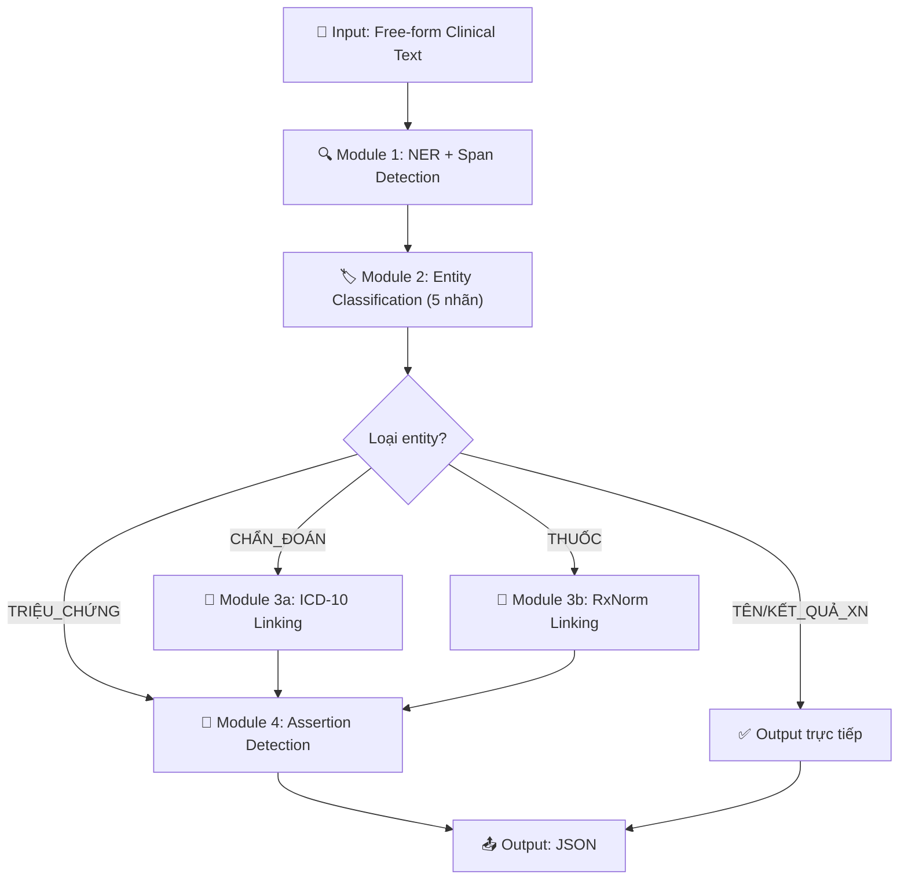
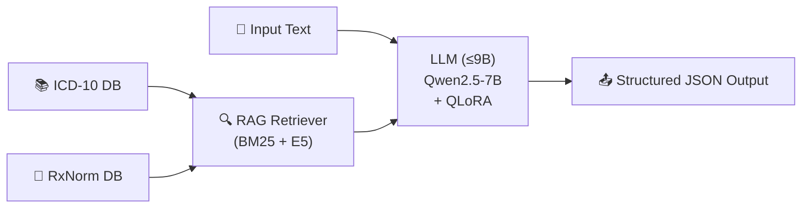
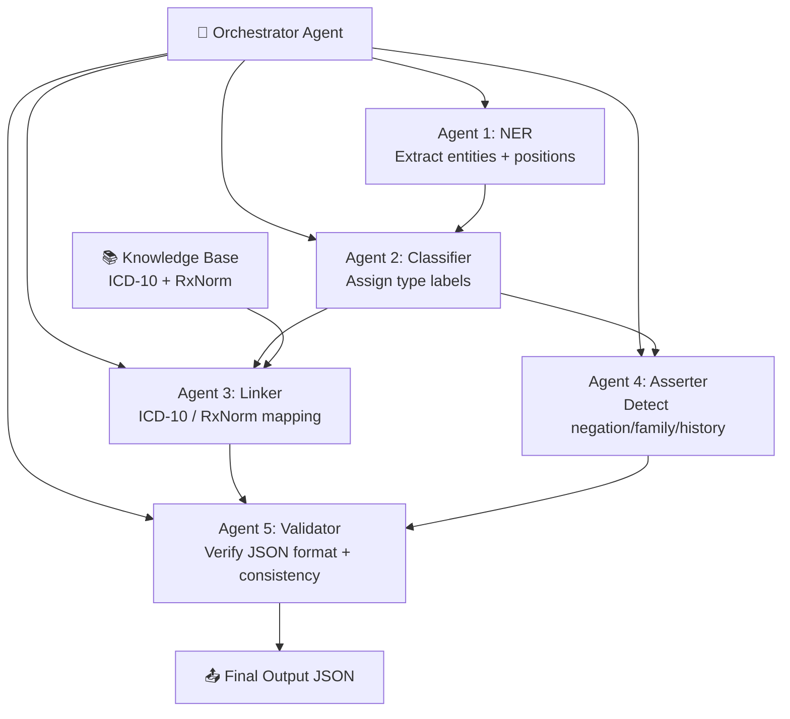
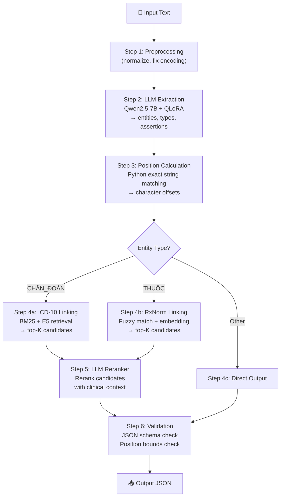

# 📋 Phân Tích Bài Toán — Clinical NLP Competition (Viettel)

> **Tài liệu tham khảo cốt lõi** — Cập nhật: 2026-07-04  
> Tác giả: AI Data Analyst & Competition Strategist

---

## 1. Tóm Tắt Mục Tiêu Bài Toán

### 1.1 Mục tiêu tổng quát

Xây dựng hệ thống AI xử lý **văn bản y khoa tiếng Việt dạng tự do** (free-form clinical text) để thực hiện **đồng thời** 4 nhiệm vụ:

| # | Nhiệm vụ | Mô tả |
|---|----------|-------|
| 1 | **Named Entity Recognition (NER)** | Phát hiện và trích xuất các khái niệm y tế trong văn bản |
| 2 | **Entity Classification** | Phân loại khái niệm vào 5 nhãn: `TRIỆU_CHỨNG`, `TÊN_XÉT_NGHIỆM`, `KẾT_QUẢ_XÉT_NGHIỆM`, `CHẨN_ĐOÁN`, `THUỐC` |
| 3 | **Entity Linking / Normalization** | Ánh xạ `CHẨN_ĐOÁN` → mã **ICD-10**, `THUỐC` → mã **RxNorm** |
| 4 | **Assertion Detection** | Xác định mối liên hệ ngữ cảnh: `isNegated`, `isFamily`, `isHistorical` |

### 1.2 Ý nghĩa thực tiễn

- Nền tảng cho **chuyển đổi số y tế**: liên thông dữ liệu lâm sàng giữa các bệnh viện
- Hỗ trợ **chẩn đoán tự động**, nghiên cứu dịch tễ, thống kê y tế
- Chuẩn hóa dữ liệu phi cấu trúc → dữ liệu có cấu trúc khai thác được

### 1.3 Ràng buộc quan trọng

> [!CAUTION]
> - **Giới hạn model**: Chỉ được self-host, tối đa **9B parameters** — KHÔNG được dùng API ngoài
> - **Không có training data**: Chỉ được cung cấp 100 bản ghi test — phải **tự tạo dữ liệu** huấn luyện
> - **Vòng 1**: Nộp file `output.zip` chứa 100 file `.json`; top ~15 đội phải nộp source code để BTC reproduce

---

## 2. Phân Tích Input/Output Chi Tiết

### 2.1 Input — Đặc điểm văn bản đầu vào

**Nguồn dữ liệu**: 100 file `.txt` trong folder `input/`, mỗi file là một đoạn văn bản y khoa tự do.

**Các dạng văn bản quan sát được từ tập test**:

| Dạng văn bản | Đặc điểm | Ví dụ file |
|--------------|----------|------------|
| **Ghi chú lâm sàng có cấu trúc** | Có tiêu đề section, dấu bullet, sub-section | `1.txt` (54 dòng, chi tiết tiền sử + khám) |
| **Hồ sơ bệnh án ngắn** | 5-15 dòng, tóm tắt lý do nhập viện + đánh giá | `2.txt`, `15.txt`, `90.txt` |
| **Văn bản rất ngắn** | < 5 dòng, chỉ chứa 1-2 khái niệm | `31.txt` (4 dòng, sản khoa), `55.txt` (7 dòng) |
| **Văn bản dài, phức tạp** | Nhiều section, xen lẫn kết quả xét nghiệm số liệu | `3.txt` (140 dòng), `41.txt` |
| **Danh sách thuốc** | Liệt kê thuốc kèm liều lượng, tần suất, chỉ định | Ví dụ trong đề bài |

**Đặc trưng ngôn ngữ quan sát được**:

```
✓ Tiếng Việt thuần (đa số)
✓ Xen lẫn thuật ngữ tiếng Anh (ECG, WBC, NEUT%, SpO2, RA, po, bid, prn...)
✓ Viết tắt y khoa: "tbm", "spo2", "ecg", "VB -", "LOF -", "FM +"
✓ Số liệu xét nghiệm: "WBC:14,43", "NEUT%:76,4"
✓ Thiếu dấu/lỗi chính tả: "cảm giáckhó chịu" (thiếu dấu cách)
✓ Cấu trúc không đồng nhất: bullet list, paragraph, mixed format
✓ Đa chuyên khoa: nội khoa, tim mạch, sản khoa, thần kinh, da liễu...
```

### 2.2 Output — Cấu trúc JSON chi tiết

Mỗi file output là một **JSON array**, mỗi phần tử là một dictionary đại diện cho một khái niệm y tế:

```json
{
  "text": "string — cụm từ gốc trong input",
  "type": "enum — 1 trong 5 nhãn",
  "position": [start, end],  // character-level, 0-indexed
  "assertions": ["isNegated" | "isFamily" | "isHistorical"],  // list, tối đa 3
  "candidates": ["mã_ICD_hoặc_RxNorm"]  // chỉ với CHẨN_ĐOÁN và THUỐC
}
```

**Chi tiết từng trường**:

#### `text` — Span Detection
- Phải khớp **chính xác** cụm từ trong văn bản gốc (bao gồm cả dấu cách, ký tự đặc biệt)
- Được đánh giá bằng **WER (Word Error Rate)** → càng thấp càng tốt

#### `type` — 5 nhãn phân loại

| Nhãn | Mô tả | Ánh xạ chuẩn | Assertions |
|------|-------|--------------|------------|
| `TRIỆU_CHỨNG` | Triệu chứng lâm sàng | ❌ Không | ✅ Có |
| `TÊN_XÉT_NGHIỆM` | Tên xét nghiệm | ❌ Không | ❌ Không |
| `KẾT_QUẢ_XÉT_NGHIỆM` | Giá trị + đơn vị xét nghiệm | ❌ Không | ❌ Không |
| `CHẨN_ĐOÁN` | Chẩn đoán bệnh | ✅ ICD-10 | ✅ Có |
| `THUỐC` | Thuốc + liều lượng | ✅ RxNorm | ✅ Có |

#### `position` — Character-level Indexing
- `[start, end]` — tính từ `0` đến `n-1` (n = độ dài input)
- **Cực kỳ nhạy cảm** với encoding, whitespace, newline characters

#### `assertions` — Contextual Inference (chỉ cho `CHẨN_ĐOÁN`, `THUỐC`, `TRIỆU_CHỨNG`)

| Assertion | Trigger ngữ cảnh | Ví dụ |
|-----------|-------------------|-------|
| `isNegated` | "không", "chưa", "phủ nhận", "loại trừ", "(-)" | *"Không buồn nôn, hay nôn"* |
| `isFamily` | "bố/mẹ/anh/chị bệnh nhân", "gia đình", "người nhà" | *"bố bệnh nhân xuất hiện đau bụng tương tự"* |
| `isHistorical` | "tiền sử", "trước đây", "trước nhập viện", "thuốc trước khi nhập viện" | *"có tiền sử hen suyễn"*, *"thuốc trước khi nhập viện"* |

> [!IMPORTANT]
> `assertions` là một list → một khái niệm có thể mang **nhiều assertion cùng lúc** (ví dụ: vừa `isHistorical` vừa `isNegated`). List rỗng `[]` nếu không có assertion nào.

#### `candidates` — Entity Linking (chỉ cho `CHẨN_ĐOÁN` và `THUỐC`)

- `CHẨN_ĐOÁN` → danh sách mã **ICD-10** (có thể nhiều mã cho 1 khái niệm, ví dụ: `["K21.0", "K21.9"]`)
- `THUỐC` → danh sách mã **RxNorm** (ví dụ: `["308135"]`)
- Các nhãn khác **KHÔNG** có trường `candidates` (hoặc không cần trả về)

---

## 3. Metric Đánh Giá — Phân Tích Công Thức Điểm

### 3.1 Công thức tổng điểm

```
final_score = 0.3 × text_score + 0.3 × assertions_score + 0.4 × candidates_score
```

### 3.2 Chi tiết từng metric

| Metric | Trọng số | Phương pháp | Ý nghĩa chiến lược |
|--------|---------|-------------|---------------------|
| **text_score** | 30% | `1 - WER(i)` trên trường `text` | NER phải chính xác từng từ |
| **assertions_score** | 30% | Jaccard similarity trên assertions | Phải đúng cả phủ định, gia đình, tiền sử |
| **candidates_score** | **40%** | Jaccard similarity, weighted by `len(ground_truth(k)) + 1` | **Chiếm trọng số lớn nhất** — entity linking quyết định thắng/thua |

### 3.3 Phân tích chiến lược từ metric

> [!WARNING]
> **Penalty khi sai nhãn `type`**: Nếu đoán đúng vị trí text nhưng **sai loại** (ví dụ: đoán `CHẨN_ĐOÁN` nhưng ground truth là `TRIỆU_CHỨNG`), khái niệm bị **tính 2 lần** (tạo ra 1 khái niệm mới so với ground truth) và mỗi lần đều được **0 điểm** cho cả 3 metric. Đây là penalty rất nặng.

**Ưu tiên chiến lược**:
1. 🥇 **candidates_score (40%)**: Đầu tư nhiều nhất vào Entity Linking — ICD-10 và RxNorm mapping
2. 🥈 **assertions_score (30%)**: Xây dựng module assertion detection chính xác
3. 🥉 **text_score (30%)**: Đảm bảo NER span detection chính xác

---

## 4. Các Thách Thức Chính (Challenges)

### 4.1 🔴 Thách thức mức Cao (Critical)

#### C1 — Zero-shot / Cold-start Problem
- **Không có training data** được cung cấp. Chỉ có 100 bản ghi test.
- Phải tự tạo dữ liệu huấn luyện (data synthesis/augmentation)
- Đây là thách thức lớn nhất: mọi pipeline ML truyền thống đều cần labeled data

#### C2 — Entity Linking đa chuẩn (ICD-10 + RxNorm)
- Phải map entity sang **2 hệ thống chuẩn y tế khác nhau** cùng lúc
- ICD-10 có **hàng chục nghìn mã**, RxNorm có **hàng trăm nghìn mã**
- Nhiều khái niệm y tế tiếng Việt **không có mapping trực tiếp** sang chuẩn quốc tế (cần dịch hoặc suy luận)
- Một chẩn đoán có thể map sang **nhiều mã ICD** (ví dụ: K21.0 + K21.9)

#### C3 — Giới hạn tài nguyên: Model ≤ 9B params, self-host only
- Không được dùng API ngoài (GPT-4, Claude, Gemini...)
- Phải tự deploy model → cần tối ưu inference
- 9B params giới hạn khả năng reasoning phức tạp

### 4.2 🟡 Thách thức mức Trung bình (Significant)

#### C4 — Đa dạng format văn bản
- Văn bản từ 4 dòng (file `31.txt`) đến 140 dòng (file `3.txt`)
- Có cấu trúc (bullet list), bán cấu trúc (section headers), và phi cấu trúc (paragraph tự do)
- Đa chuyên khoa: tim mạch, sản khoa, thần kinh, tiêu hóa, da liễu...

#### C5 — Viết tắt, ký hiệu, code-switching
- Viết tắt tiếng Việt: "tbm", "sđt"
- Viết tắt tiếng Anh: "po", "bid", "prn", "q6h", "qam", "qhs", "ECG"
- Ký hiệu y khoa: "(-)", "(+)", "N/A", "FM +", "VB -", "LOF -"
- Code-switching Việt-Anh trong cùng một câu

#### C6 — Assertion Detection — suy luận ngữ cảnh sâu
- **Phủ định (isNegated)**: "Không buồn nôn, hay nôn, đổ mồ hôi" → phủ định cả 3 triệu chứng
- **Phủ định xa**: phủ định ở đầu câu nhưng tác động đến entity ở cuối câu
- **Gia đình (isFamily)**: Cần hiểu cấu trúc câu phức — "bố bệnh nhân" vs "bệnh nhân"
- **Tiền sử (isHistorical)**: "Thuốc trước khi nhập viện" → toàn bộ thuốc phía dưới là `isHistorical`
- Assertion có thể **kết hợp** (ví dụ: thuốc tiền sử bị ngưng = `isHistorical` + `isNegated`)

#### C7 — Character-level Position Accuracy
- Position tính theo **ký tự Unicode**, không phải byte
- Encoding tiếng Việt (dấu, Unicode combining characters) dễ gây lệch offset
- Lỗi chính tả trong input (ví dụ: "cảm giáckhó chịu") làm phức tạp hóa span detection
- Newline characters (`\r\n` vs `\n`) ảnh hưởng đến offset

### 4.3 🟢 Thách thức mức Thấp (Manageable)

#### C8 — Ranh giới entity mơ hồ
- "Chlorpheniramine 0.4 MG/ML" → entity bao gồm cả liều lượng hay chỉ tên thuốc?
- "tổng phân tích tế bào máu bằng máy lazer" → span bao gồm "bằng máy lazer" hay không?
- "NEUT% (Tỷ lệ % bạch cầu trung tính)" → toàn bộ chuỗi hay chỉ "NEUT%"?

#### C9 — Entity trùng lặp trong cùng văn bản
- Cùng một triệu chứng xuất hiện nhiều lần ("táo bón" × 2, "lo âu" × 2 trong ví dụ output)
- Mỗi occurrence phải được extract riêng với position chính xác

---

## 5. Gợi Ý Hướng Giải Pháp (Solution Approaches)

### 5.1 Tổng quan Pipeline



---

### 5.2 Approach 1 — Rule-based + Dictionary (Baseline)

**Mức độ phức tạp**: ⭐  
**Hiệu quả kỳ vọng**: Thấp–Trung bình  
**Phù hợp khi**: Cần baseline nhanh, hiểu dữ liệu

#### Ý tưởng
- Xây dựng dictionary thuật ngữ y khoa tiếng Việt cho mỗi nhãn
- Dùng string matching / regex để detect entity
- Ánh xạ từ điển → ICD-10, RxNorm
- Rule-based assertion: detect từ phủ định, từ chỉ gia đình, từ chỉ tiền sử

#### Thành phần

| Module | Kỹ thuật |
|--------|----------|
| NER | Regex + Dictionary lookup (thuật ngữ y khoa) |
| Classification | Rule-based (nếu match dict thuốc → `THUỐC`, dict bệnh → `CHẨN_ĐOÁN`...) |
| Linking | Fuzzy string matching (Levenshtein, Jaccard) với bảng ICD-10/RxNorm |
| Assertion | Keyword patterns: "không" → `isNegated`, "tiền sử" → `isHistorical`, "bố/mẹ/anh/chị" → `isFamily` |

#### Ưu điểm
- Nhanh, không cần GPU
- Không cần training data
- Dễ debug, dễ hiểu

#### Nhược điểm
- Không xử lý được biến thể diễn đạt, viết tắt lạ
- Precision/Recall thấp cho entity phức tạp
- Phủ định phạm vi xa (long-range negation) rất khó xử lý bằng rule

---

### 5.3 Approach 2 — Transformer NER + Embedding Retrieval (Intermediate)

**Mức độ phức tạp**: ⭐⭐⭐  
**Hiệu quả kỳ vọng**: Trung bình–Khá  
**Phù hợp khi**: Có GPU, cần balance giữa accuracy và complexity

#### Ý tưởng
- Fine-tune model NER (PhoBERT / XLM-RoBERTa) cho token classification
- Dùng sentence embedding (SapBERT / multilingual E5) để retrieval ICD-10/RxNorm candidates
- Train classifier riêng cho assertion detection

#### Pipeline chi tiết

```
Input Text
    │
    ▼
[PhoBERT/XLM-R] → Token Classification (BIO tagging) → Entities + Types
    │
    ▼
[SapBERT / E5-large] → Encode entity → Cosine similarity với ICD-10/RxNorm embeddings
    │                                     → Top-K candidates
    ▼
[Assertion Classifier] → Binary classification cho mỗi assertion
    │
    ▼
Output JSON
```

#### Thành phần chi tiết

| Module | Model | Training Strategy |
|--------|-------|-------------------|
| NER | `vinai/phobert-base` hoặc `xlm-roberta-base` | Fine-tune với BIO tagging trên synthetic data |
| Linking | `cambridgeltl/SapBERT-UMLS` hoặc `intfloat/multilingual-e5-large` | Pre-compute embeddings cho toàn bộ ICD-10 + RxNorm, tìm top-K bằng cosine similarity |
| Assertion | Binary classifier (BERT-based) hoặc rule-based hybrid | Train trên synthetic assertion examples |

#### Chiến lược tạo dữ liệu
1. **Dịch + adapt** clinical NER datasets tiếng Anh (i2b2, n2c2, ShARe/CLEF) sang tiếng Việt
2. **GPT-generated synthetic data**: Dùng LLM tạo ví dụ y khoa tiếng Việt + label
3. **Active learning**: Chạy model trên test set, manually verify, bổ sung vào training set

#### Ưu điểm
- Tận dụng được pre-trained medical embeddings
- Xử lý tốt biến thể diễn đạt hơn rule-based
- Modular: dễ cải thiện từng module độc lập

#### Nhược điểm
- Cần synthetic training data chất lượng
- SapBERT chủ yếu train trên tiếng Anh — cần multilingual adapter
- Pipeline nhiều bước → lỗi tích lũy (error propagation)

---

### 5.4 Approach 3 — LLM-based End-to-End (Recommended) ⭐

**Mức độ phức tạp**: ⭐⭐⭐⭐  
**Hiệu quả kỳ vọng**: Cao  
**Phù hợp khi**: Cần accuracy cao nhất, chấp nhận đầu tư thời gian

#### Ý tưởng
- Sử dụng LLM ≤ 9B (Qwen2.5-7B, Llama-3.1-8B, Gemma-2-9B) làm backbone
- Thiết kế prompt engineering hoặc fine-tune (QLoRA) cho toàn bộ pipeline
- Kết hợp RAG (Retrieval-Augmented Generation) với database ICD-10/RxNorm

#### Architecture



#### Hai chiến lược chính

**Chiến lược A — Prompt Engineering (Zero/Few-shot)**:
- Thiết kế system prompt chi tiết mô tả task
- Few-shot examples trong prompt
- Constrained decoding để đảm bảo output JSON hợp lệ
- Kết hợp RAG: trước khi gọi LLM, retrieve top-K ICD/RxNorm candidates, đưa vào prompt

**Chiến lược B — QLoRA Fine-tuning**:
- Fine-tune LLM trên synthetic clinical NER + linking data
- Input: clinical text + retrieved candidates
- Output: structured JSON
- Dùng 4-bit quantization để fit vào GPU

#### Prompt Template gợi ý (Chiến lược A)

```
Bạn là chuyên gia NLP y khoa. Phân tích văn bản y khoa sau và trích xuất TẤT CẢ khái niệm y tế.

Với mỗi khái niệm, xác định:
1. text: cụm từ chính xác trong văn bản
2. type: TRIỆU_CHỨNG | TÊN_XÉT_NGHIỆM | KẾT_QUẢ_XÉT_NGHIỆM | CHẨN_ĐOÁN | THUỐC
3. position: [start, end] (0-indexed, character-level)
4. assertions: ["isNegated", "isFamily", "isHistorical"] nếu có
5. candidates: mã ICD-10 (cho CHẨN_ĐOÁN) hoặc RxNorm (cho THUỐC)

Các mã ICD-10/RxNorm khả thi cho entities phát hiện được:
{retrieved_candidates}

Văn bản y khoa:
---
{input_text}
---

Trả lời dưới dạng JSON array:
```

#### Các LLM phù hợp (≤ 9B)

| Model | Params | Ưu điểm | Nhược điểm |
|-------|--------|---------|------------|
| **Qwen2.5-7B-Instruct** | 7B | Mạnh về tiếng Việt, structured output tốt | Cần quantize cho GPU nhỏ |
| **Llama-3.1-8B-Instruct** | 8B | Reasoning tốt, cộng đồng lớn | Tiếng Việt yếu hơn Qwen |
| **Gemma-2-9B-IT** | 9B | Google, multilingual tốt | Gần limit 9B |
| **Mistral-7B-Instruct-v0.3** | 7B | Nhanh, efficient | Tiếng Việt hạn chế |
| **Vistral-7B / VinaLLaMA** | 7B | Tối ưu tiếng Việt | Ít cập nhật, ít fine-tune medical |

> [!TIP]
> **Khuyến nghị**: **Qwen2.5-7B-Instruct** hoặc bản fine-tuned medical (nếu có) là lựa chọn tối ưu nhất cho tiếng Việt y khoa. Kết hợp QLoRA fine-tuning trên synthetic data sẽ cho kết quả tốt nhất.

---

### 5.5 Approach 4 — Multi-Agent System (Advanced)

**Mức độ phức tạp**: ⭐⭐⭐⭐⭐  
**Hiệu quả kỳ vọng**: Cao nhất (nếu implement tốt)  
**Phù hợp khi**: Có đủ thời gian, muốn maximize điểm

#### Ý tưởng
- Chia pipeline thành nhiều agent chuyên biệt, mỗi agent xử lý 1 sub-task
- Các agent giao tiếp qua shared context
- Có meta-agent (orchestrator) điều phối luồng xử lý

#### Kiến trúc đề xuất



#### Ưu điểm
- Mỗi agent được tối ưu cho sub-task riêng
- Có thể dùng **model nhỏ hơn** cho mỗi agent (ví dụ: 3B cho NER, 7B cho Linking)
- Agent Validator giúp tự sửa lỗi (self-correction)
- Dễ mở rộng, thêm agent mới

#### Nhược điểm
- Phức tạp, khó implement và debug
- Inference chậm (chạy nhiều model sequentially)
- Overhead giao tiếp giữa agents

---

### 5.6 Approach 5 — Hybrid Pipeline (Practical Best) 🏆

**Mức độ phức tạp**: ⭐⭐⭐⭐  
**Hiệu quả kỳ vọng**: Cao — Cân bằng tốt giữa accuracy, speed, và complexity  
**Phù hợp khi**: Cần kết quả tốt nhất trong thời gian giới hạn

> [!IMPORTANT]
> **Đây là approach được khuyến nghị cho cuộc thi** — kết hợp điểm mạnh của nhiều phương pháp.

#### Architecture



#### Chi tiết từng step

| Step | Công cụ | Chi tiết |
|------|---------|----------|
| **Preprocessing** | Python | Normalize Unicode (NFC), fix whitespace, detect encoding |
| **LLM Extraction** | Qwen2.5-7B + QLoRA | Extract entities + types + assertions trong 1 lần gọi |
| **Position Calc** | Python `str.find()` / regex | Tính chính xác character offset bằng code, **KHÔNG** dùng LLM |
| **ICD-10 Linking** | BM25 + E5 embedding | Retrieve top-20 candidates, dùng LLM rerank chọn top-K |
| **RxNorm Linking** | RxNorm API / fuzzy match | Tên thuốc thường chuẩn hóa hơn → dễ match hơn |
| **Validation** | Python | Check JSON schema, position bounds, type consistency |

> [!TIP]
> **Điểm mấu chốt**: Dùng LLM cho phần cần **reasoning** (NER, assertion), dùng **code** cho phần cần **precision** (position calculation, JSON formatting), và dùng **retrieval** cho phần cần **knowledge** (entity linking).

---

## 6. Chiến Lược Tạo Dữ Liệu (Data Synthesis)

Vì không có training data, việc tạo dữ liệu chất lượng là **yếu tố quyết định**:

| Phương pháp | Mô tả | Chất lượng |
|-------------|-------|------------|
| **Dịch dataset tiếng Anh** | Dịch i2b2 2010/2012, n2c2, ShARe/CLEF → tiếng Việt | Trung bình (cần post-edit) |
| **LLM synthetic generation** | Dùng LLM tạo văn bản y khoa tiếng Việt + ground truth | Cao (nếu prompt tốt) |
| **Template-based generation** | Tạo template câu lâm sàng, fill slot với entity random | Trung bình (ít đa dạng) |
| **Augmentation từ test set** | Paraphrase, thay entity, thay ngữ cảnh từ 100 file test | Cao (sát distribution) |
| **Crawl + annotate** | Crawl case study y khoa tiếng Việt, annotate bằng LLM | Cao (real data) |

---

## 7. Checklist Thực Thi Nhanh

```
Phase 1 — Setup & Baseline (Ngày 1-2)
├── [ ] Download và phân tích toàn bộ 100 file test
├── [ ] Chuẩn bị database ICD-10 và RxNorm (download, index)
├── [ ] Implement rule-based baseline → nộp first submission
└── [ ] Đánh giá baseline trên sample data

Phase 2 — Data Synthesis (Ngày 2-4)
├── [ ] Tạo 500-1000 synthetic training samples
├── [ ] Dịch + adapt clinical NER datasets (i2b2, n2c2)
├── [ ] Validate chất lượng synthetic data
└── [ ] Chuẩn bị ICD-10/RxNorm embedding index

Phase 3 — Model Development (Ngày 4-7)
├── [ ] Setup Qwen2.5-7B + QLoRA fine-tuning
├── [ ] Train NER + Classification + Assertion module
├── [ ] Build RAG pipeline cho Entity Linking
├── [ ] Implement position calculation module (Python)
└── [ ] Build JSON validation & formatting module

Phase 4 — Optimization (Ngày 7-10)
├── [ ] Error analysis trên test set
├── [ ] Cải thiện assertion detection (edge cases)
├── [ ] Tối ưu entity linking (reranking, thresholds)
├── [ ] Ensemble / self-consistency voting
└── [ ] Final submission + source code cleanup
```

---

## 8. Tổng Kết

| Khía cạnh | Điểm quan trọng |
|-----------|-----------------|
| **Bài toán** | Multi-task: NER + Classification + Linking + Assertion |
| **Ngôn ngữ** | Tiếng Việt y khoa, xen lẫn tiếng Anh, viết tắt, đa chuyên khoa |
| **Dữ liệu** | 100 file test (không có train) — phải tự tạo data |
| **Ràng buộc** | Model ≤ 9B, self-host only, no external API |
| **Metric quyết định** | `candidates_score` chiếm **40%** → Entity Linking là trọng tâm |
| **Approach khuyến nghị** | Hybrid Pipeline: LLM (NER+Assertion) + Retrieval (Linking) + Code (Position) |
| **Model khuyến nghị** | Qwen2.5-7B-Instruct + QLoRA |
| **Rủi ro lớn nhất** | Sai nhãn `type` → penalty 0 điểm cho cả 3 metric |

> [!NOTE]
> Tài liệu này nên được cập nhật liên tục khi có thêm thông tin từ BTC hoặc phát hiện mới từ quá trình phân tích dữ liệu test.
